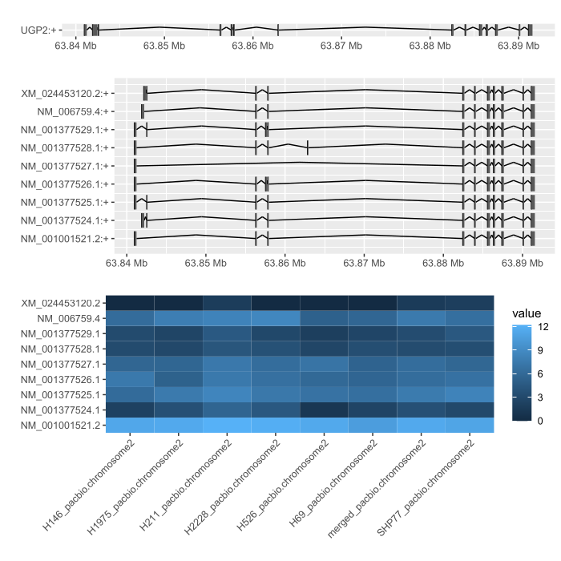
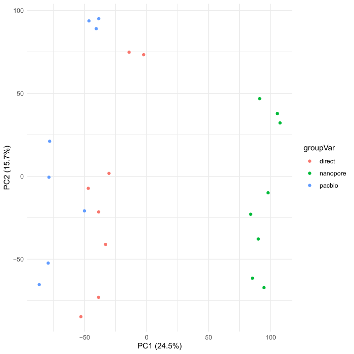

```{=html}
<script src="https://kit.fontawesome.com/ece750edd7.js" crossorigin="anonymous"></script>
```

For transcript quantification, again there are several tools that can be used. Some tools require transcript identification first (FLAIR), but there are many others that can work directly from mapped reads. During this session we will take a look at **Bambu**, a tool for quantifying reads on a transcript or gene level.

## Bambu

In some cases, we specifically want to get counts per gene for a version of an annotation, without looking for new isoforms or transcripts. Though Bambu is capable of also identifying new isoforms and transcripts, it is mainly used with organisms that already have a high quality annotation. To able to do this, we again need the mapped reads, a genome sequence and a genome annotation.

Bambu is based within R, a popular programming language used in bioinformatics. Bambu requires one of the latest versions of R, which we have installed for you on the server.

::: objectives
<h2><i class="fas fa-pencil-alt"></i> Disclaimer:</h2>

For this course, no prior experience with R or programming is required. You will be able to follow along by simply copying and pasting the commands provided into R. We will focus on understanding what the commands do and how to interpret the results, rather than on learning how to write code from scratch.

That said, if you are interested in working with transcriptomics data, learning R is worthwhile. R is one of the most widely used programming languages for analysing biological data, and it is particularly useful for data analysis and data visualization.

If you are interested in getting started with R, we would also recommend taking a look at RStudio. RStudio provides a user-friendly graphical interface for working with R. It makes programming much more accessible by allowing you to write and organize scripts, run individual commands, view plots, and inspect your data, all within one interface.

Unfortunately, we will not be using RStudio during this course. We are running a specific version of R on a remote server, and the RStudio interface is not currently available for this version of R. Instead, we will work directly with R and use the commands provided throughout the course. This is perfectly sufficient for following the exercises and completing the analyses covered in the course. Click [here](https://rstudio-core3.bio.ed.ac.uk/) to take a look at the Rstudio interface.

If you are interested in learning R and would like to join a course that will teach you how to use R from the very beginning, please contact the Bioinformatics Core at the [DRP-HCB](https://biology.ed.ac.uk/drp).
:::

R runs from your current working directory, meaning it has access to the data within that folder and will write any output files to that folder.

Start R by running the following command in the terminal.

``` bash
/library/training/LRT_Tool/R-4.6.0/bin/R
```

The Bambu package needs to be installed within R. ***Note**: You won't need to run this when working on the server.*

``` bash
BiocManager::install("bambu")
```

Once packages are installed, they still need to activated.

``` bash
library(bambu)
```

The command below lists all of the input files for bambu by looking for files ending with `pacbio.chromosome2.bam`. Multiple samples can be loaded at the same time and the larger the number of samples, the longer the process will take. Running bambu on a server is advised to speed up this process.

``` bash
files <- list.files(path="./", pattern="pacbio.chromosome2.bam$")
```

:::: challenge
<h2><i class="fas fa-pencil-alt"></i> Challenge:</h2>

How many files have we prepared for Bambu?

<details>

<summary>Solution</summary>

::: solution
<h2><i class="far fa-eye"></i> Solution:</h2>

Don't worry if you don't know how to use R. To get the values within a variable in R, just type its name and press enter.

``` bash
files
```
:::

</details>
::::

We can run bambu with a single command. Bambu first prepares the annotation for efficient access. If you use the genome often, the annotation can be prepared beforehand and saved into an R object to save time.

``` bash
se <- bambu(reads = files, annotations = "../GCF_000001405.40_GRCh38.p14_genomic.gtf", genome = "../GCF_000001405.40_GRCh38.p14_genomic.fna", ncore = 5, discovery = FALSE)
```

***Note**: This will take several minutes.*

Once bambu has finished, we can write the output to a folder named `bambu`.

``` bash
writeBambuOutput(se, path = "./bambu/")
```

Open up a **new terminal** to take a look at the resulting files. We want to keep the R session running to be able to continue working with the data later on.

Several files are generated, the most important are the files starting with `counts`. Bambu generates files for both transcript level and gene level. Depending on the analysis, either file can be used.

:::: challenge
<h2><i class="fas fa-pencil-alt"></i> Challenge:</h2>

How many transcripts have been reported? And how many genes?

<details>

<summary>Solution</summary>

::: solution
<h2><i class="far fa-eye"></i> Solution:</h2>

Remember that we can check how many lines a file has with `wc -l`.

``` bash
wc -l counts_transcript.txt

wc -l counts_gene.txt
```
:::

</details>
::::

Bambu has the functionality to visualise genes, the different transcripts found for a gene, and the per sample read counts for each transcript. This can help you to visualise specific transcripts that are being used differently between sample groups. Because we are working on the command line, we cannot directly see the plots, however we can easily save them to a pdf file.

``` bash
pdf("UGP2.pdf")
plotBambu(se, type = "annotation", gene_id = "UGP2")
dev.off()
```

The plot is saved to the current working directory. View the plot in your web directory or view the prepared version below.



:::: challenge
<h2><i class="fas fa-pencil-alt"></i> Challenge:</h2>

How many transcripts have been reported for UGP2?

<details>

<summary>Solution</summary>

::: solution
<h2><i class="far fa-eye"></i> Solution:</h2>

The top of the image shows the different transcripts available for the gene.
:::

</details>
::::

Bambu also has options to create other plots like PCA and heatmaps.

Because we have data for all samples using PacBio, Nanopore Direct sequencing and Nanopore RNA sequencing, we have prepared a set of data which contain the results for all samples using bambu.

To load the data into R, run the following command.

``` bash
seall <- readRDS(file="bamburesults_allsamples.rds")
```

To create a pca plot which shows information on groups, group information needs to be added to the R object that we want to look at. Within bambu, information of samples is captured in colData(seall).

:::: challenge
<h2><i class="fas fa-pencil-alt"></i> Challenge:</h2>

Run `colData(seall)` in R.

What information is currently available for the samples?

<details>

<summary>Solution</summary>

::: solution
<h2><i class="far fa-eye"></i> Solution:</h2>

The only information currently available is the names of the samples.
:::

</details>
::::

There are several ways to add data, for now we will add data manually. This is normally not recommended, as mistakes are easily made, but for this example it will do.

``` bash
colData(seall)$seqtype <- c("direct", "nanopore", "pacbio","direct", "nanopore", "pacbio","direct", "nanopore", "pacbio","direct", "nanopore", "pacbio","direct", "nanopore", "pacbio","direct", "nanopore", "pacbio","direct", "nanopore", "pacbio","direct", "nanopore", "pacbio")
```

Now, let's create a pca plot.

``` bash
pdf("pcaseall.pdf")
plotBambu(seall, type="pca", "seqtype")
dev.off()
```

View the plot in your web folder or view a prepared version below.



::: challenge
<h2><i class="fas fa-pencil-alt"></i> Challenge:</h2>

Is there anything that stands out to you from the pca plot?
:::
