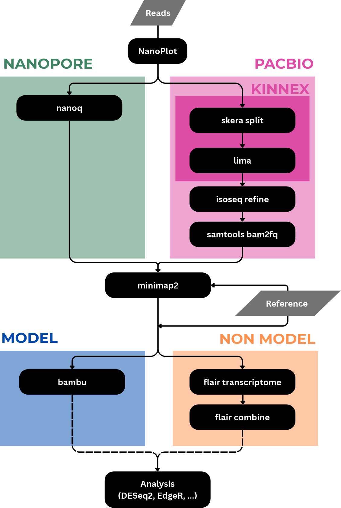

This summary should help you decide which steps are necessary for you to start analysing your data. The most important considerations before you start are the platform used for sequencing reads and quality and completeness of your reference genome.

Processing PacBio data is generally more involved than processing Nanopore data. However, PacBio data typically generates higher read quality, which can be beneficial for downstream analyses, especially if you are working with an unknown species. You can inspect the NanoPlot quality control reports to check whether Kinnex was used and whether the data has already undergone preprocessing when looking at PacBio. Whether using PacBio or Nanopore, these reports are useful to understand the data that you are working and the impact the quality of the reads will have on downstream results.

If you are working with a well-annotated genome, such as a model organism, or with a genome that has some basic annotation available but where the annotations have not been experimentally or independently validated and are likely to be incomplete.

If your genome does not have any annotation at all, doing a genome annotation using a tool such as [BRAKER3](https://pubmed.ncbi.nlm.nih.gov/37398387/) can be extremely valuable. This will provide an initial set of predicted genes and transcripts, giving you a starting point for downstream analyses.

An overview of the workflow is given below.

{width="500"}
