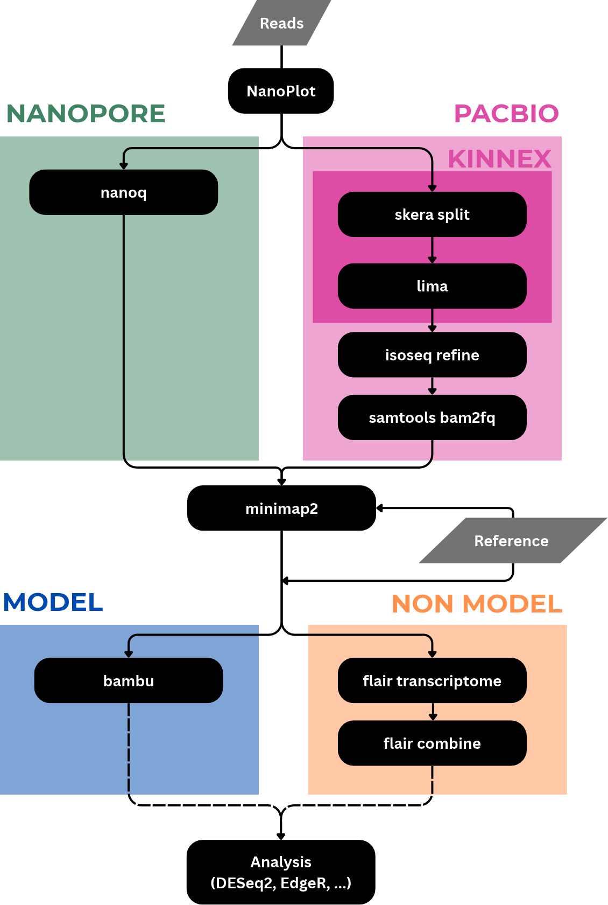

Welcome to our *Long Read Transcriptomics* course. This course is hosted by the Bioinformatics Core at the [DRP-HCB](https://biology.ed.ac.uk/drp).

During this course you will learn to:

-   Perform quality control checks on long read transcriptomics data
-   Map long reads reads to a reference genome
-   Identify new genes and isoforms
-   Quantify expression of genes and isoforms

During this course, we will work through the following workflow and explain the process, different steps to take depending on the data that we have, and talk about things to watch out.

{width="500"}

